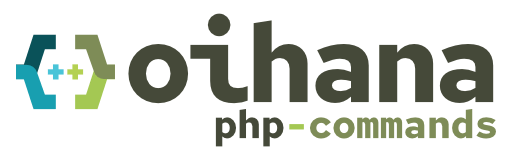

# Oihana PHP Commands



Build robust, scriptable command-line tooling for servers and web applications. Part of the **Oihana PHP** ecosystem, this package gives you a consistent foundation to automate day‑to‑day operations with confidence.

[](https://packagist.org/packages/oihana/php-commands)
[](https://packagist.org/packages/oihana/php-commands)
[](LICENSE)

## 📚 Documentation

Full documentation: `https://bcommebois.github.io/oihana-php-commands`

## 📦 Installation

Requires [PHP 8.4+](https://php.net/releases/). Install via [Composer](https://getcomposer.org/):

```bash
composer require oihana/php-commands
```

## ✨ What you can do

- Manage MySQL databases: create users, grant privileges, back up and restore data.
- Automate backups: schedule and execute incremental or full backups for databases and apps.
- Install and update applications: deploy, upgrade, and maintain projects reliably.
- Control caches: clear and manage systems like Memcached and Redis.
- Handle SSL certificates: automate issuance and renewal with Let’s Encrypt/Certbot.
- Configure NGINX: generate modular server configs and reload services.
- Schedule jobs: keep a crontab in line with the jobs an application declares.

### Under the hood

- First‑class integration with Symfony Console for building custom CLI commands.
- Ready‑made plugins for databases, caches, web servers, certificates, and more.
- A flexible options system based on the [PSR‑11 Container](https://www.php-fig.org/psr/psr-11/).
- An extensible architecture to add your own tasks, workflows, and plugins.

Ideal for DevOps automation, hosting management, CI/CD pipelines, and local or production environment setup.

## ⏰ Scheduled jobs

`CronCommand` keeps the crontab of the current user in line with the jobs an application declares.
It owns only the lines that end with its marker, `# oihana-cron:<scope>:<name>`: everything else in
the crontab stays as it is.

```php
use oihana\commands\cron\CronCommand;
use oihana\commands\enums\CronParam;

$command = new CronCommand( 'app:cron' , $container ,
[
    CronParam::SCOPE   => 'myapp-staging' ,
    CronParam::BACKUPS => '/srv/app/var/crontab' ,
    CronParam::JOBS    =>
    [
        [
            'name'     => 'check' ,
            'schedule' => '0 6 * * 1-6' ,
            'command'  => '/usr/bin/php /srv/app/bin/console.php app:check' ,
            'log'      => '/srv/app/logs/cron/check.log' ,
        ] ,
    ] ,
]) ;
```

```
bin/console app:cron list            # the jobs, and what sync would do
bin/console app:cron sync            # the changes the crontab needs — nothing is written
bin/console app:cron sync --apply    # copy the crontab, then write the changes
bin/console app:cron sync --check    # ends on 1 when the crontab is not up to date — nothing is written
bin/console app:cron disable check   # comment the line out, until the next sync
```

Cron starts its jobs with a minimal environment: write commands with absolute paths.

## 🔌 Plugins

Each plugin extends the CLI with focused, production‑ready capabilities.

| 🔌 | Plugin                                                                     | Description                                                            |
|----|----------------------------------------------------------------------------|------------------------------------------------------------------------|
| 🔏 | [Oihana PHP Certbot](https://github.com/BcommeBois/oihana-php-certbot)     | Create, modify and manage Let’s Encrypt certificates via Certbot.      |
| 🧠 | [Oihana PHP Memcached](https://github.com/BcommeBois/oihana-php-memcached) | Manage Memcached in‑memory key‑value caching.                           |
| 🌐 | [Oihana PHP Nginx](https://github.com/BcommeBois/oihana-php-nginx)         | Create, modify and control NGINX configurations and commands.          |
| 🤖 | [Oihana PHP Robots](https://github.com/BcommeBois/oihana-php-robots)       | Create or remove a robots.txt file from the CLI.                       |

---

### 🔏 Certbot

<a href="https://github.com/BcommeBois/oihana-php-certbot">
  
  </a>

Toolkit to create, modify and manage [Let’s Encrypt](https://letsencrypt.org/) certificates via the [Certbot](https://certbot.eff.org/) CLI.

🔗 View the repository: `https://github.com/BcommeBois/oihana-php-certbot`

---

### 🧠 Memcached

<a href="https://github.com/BcommeBois/oihana-php-memcached">
  
  </a>

CLI to control Memcached using the official [Memcached](https://www.php.net/manual/en/book.memcached.php) PHP extension.

🔗 View the repository: `https://github.com/BcommeBois/oihana-php-memcached`

---

### 🌐 Nginx

<a href="https://github.com/BcommeBois/oihana-php-nginx">
  
  </a>

Simple CLI to manage NGINX and create/remove configuration files on your server.

🔗 View the repository: `https://github.com/BcommeBois/oihana-php-nginx`

---

### 🤖 Robots

<a href="https://github.com/BcommeBois/oihana-php-robots">
  
  </a>

CLI to create or remove a website’s `robots.txt` file.

🔗 View the repository: `https://github.com/BcommeBois/oihana-php-robots`

## ✅ Running tests

Run all tests:

```bash
composer test
```

Run a specific test file:

```bash
composer test ./tests/oihana/commands/ProcessTest.php
```

## 🛠️ Generate the documentation

We use [phpDocumentor](https://phpdoc.org/) to generate documentation into the `./docs` folder.

```bash
composer doc
```

## 🧾 License

Licensed under the [Mozilla Public License 2.0 (MPL‑2.0)](https://www.mozilla.org/en-US/MPL/2.0/).

## 👤 About the author

- Author: Marc ALCARAZ (aka eKameleon)
- Email: `marc@ooop.fr`
- Website: `https://www.ooop.fr`

## 🔗 Related packages

- `oihana/php-core` – core helpers and utilities used by this library: `https://github.com/BcommeBois/oihana-php-core`
- `oihana/php-reflect` – reflection and hydration utilities: `https://github.com/BcommeBois/oihana-php-reflect`
- `oihana/php-system` – common helpers of the Oihana PHP framework: `https://github.com/BcommeBois/oihana-php-system`
- `oihana/php-schema` – object‑oriented implementation of the Schema.org vocabulary: `https://github.com/BcommeBois/oihana-php-schema`
- `oihana/php-standards` – constants and helpers based on major international standards (ISO, UN, UN/CEFACT, etc.): `https://github.com/BcommeBois/oihana-php-standards`